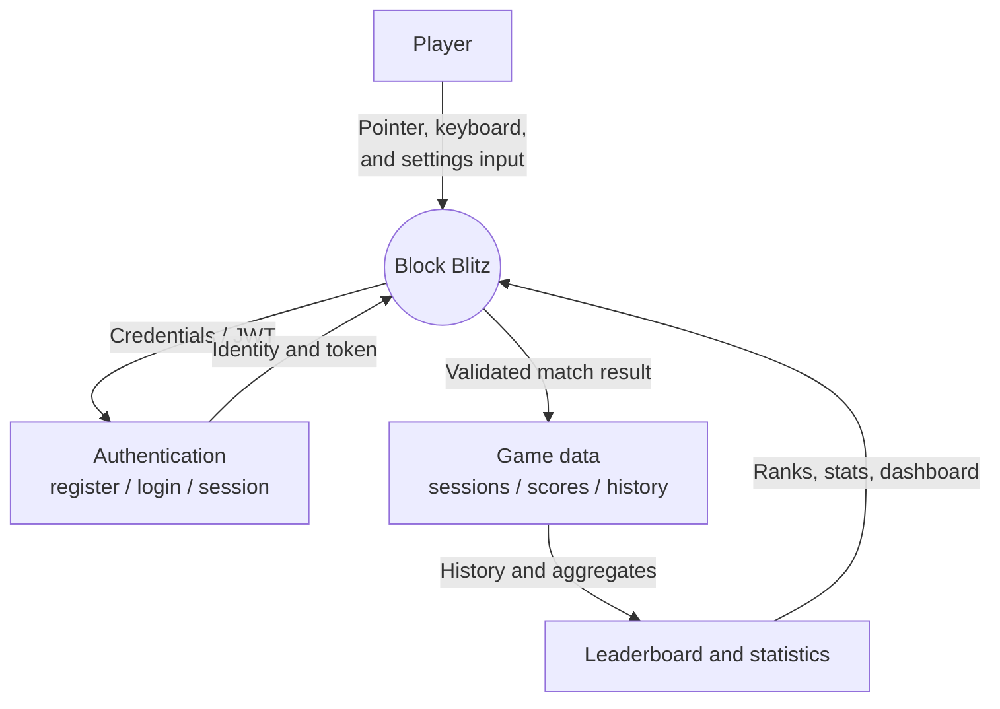
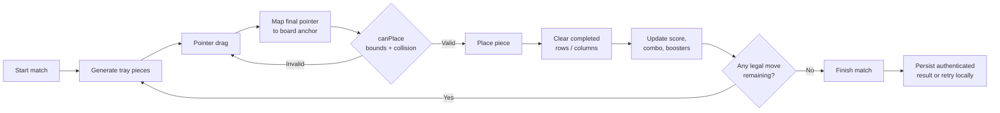
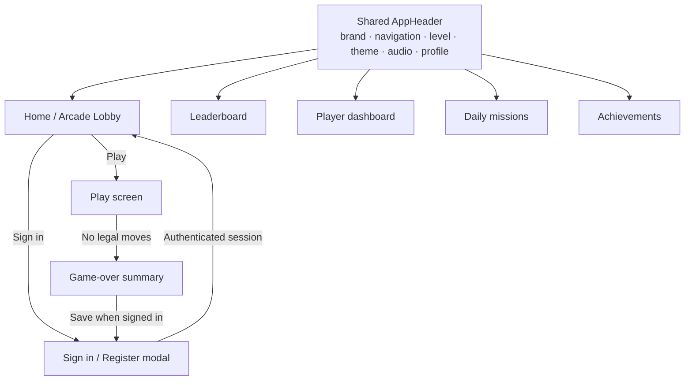

# Block Blitz

Block Blitz is a responsive 8x8 block-placement puzzle game. Place the three
generated pieces, clear complete rows or columns, build combos, and continue
until none of the remaining pieces fit. Gameplay, scoring, boosters, and the
visual layout are implemented in the React client; authenticated scores are
stored in PostgreSQL through the Express API.

## Features

- Pointer-based mouse, touch, and pen placement with valid/invalid previews.
- 8x8 board, row/column clears, combos, reroll, hammer, and undo boosters.
- Anonymous local play and authenticated history, dashboard statistics, and
  global leaderboards.
- MP3 background music plus Web Audio sound effects.
- Server-side plausibility validation and flagged-score review state.
- Persistent client retry queue for finished authenticated matches.

## Gameplay

Drag a tray piece onto the board. A piece is accepted only when every occupied
cell is inside the board and empty. A completed row or column is cleared
immediately. A match ends when no available piece can be placed.

## Scoring

The client uses the existing scoring implementation in
[`client/src/game/scoring.ts`](client/src/game/scoring.ts). The formula is:

`placement score = base piece-cell points + line-clear points + combo bonus`

The exact constants are defined in that source file and are not duplicated in
the API. The server applies plausibility ceilings; it does not recalculate the
game from a seeded piece stream.

## Architecture

```text
React/Vite client
       |
       | HTTPS JSON + Bearer JWT
       v
Express API (server/src)
       |
       | parameterized SQL / PostgreSQL transactions
       v
PostgreSQL
```

## Data-flow diagrams and visual presentation

### DFD level 0: system context



### DFD level 1: match lifecycle



The preview is visual only. Placement is recalculated from the final pointer
coordinates on release, and the same pure `canPlace` rule is used for preview,
drop validation, and game-over detection.

### Client presentation and screen map



### Responsive visual presentation

| Viewport | Header presentation | Main presentation |
|---|---|---|
| Desktop (`>= 1100px`) | Fixed shared header with navigation pills, level chip, theme, audio, and profile | Three-column lobby: player card, centered hero board, top ranks |
| Tablet (`640–1099px`) | Fixed header with menu and settings controls | Centered hero with stacked content and compact rails |
| Mobile (`< 640px`) | Brand, level, settings, and profile controls; bottom navigation dock | Single-column hero, player card, ranks card, and How It Works |

The visual language is consistent across screens:

- Deep navy surfaces with emerald accents and restrained borders.
- Emerald gradient typography for the `BLITZ` wordmark and hero title.
- 40px header controls and at least 44px touch targets for interactive actions.
- Shared audio, theme, and settings controls across the home and play layouts.
- Focus-visible rings, reduced-motion support, and keyboard-accessible dialogs,
  switches, and game actions.

### Core client modules

| Area | Primary modules |
|---|---|
| Shared shell | [`client/src/components/AppHeader.tsx`](client/src/components/AppHeader.tsx), [`client/src/components/appHeader.css`](client/src/components/appHeader.css) |
| Home presentation | [`client/src/components/HomeScreen.tsx`](client/src/components/HomeScreen.tsx), [`client/src/components/arcadeLobby.css`](client/src/components/arcadeLobby.css) |
| Gameplay | [`client/src/components/GameBoard.tsx`](client/src/components/GameBoard.tsx), [`client/src/components/PieceTray.tsx`](client/src/components/PieceTray.tsx) |
| Placement | [`client/src/game/placement.ts`](client/src/game/placement.ts), [`client/src/game/dragGeometry.ts`](client/src/game/dragGeometry.ts) |
| Authentication | [`client/src/components/AuthModal.tsx`](client/src/components/AuthModal.tsx), [`server/src/routes/auth.ts`](client/src/routes/auth.ts) |
| Persistence | [`client/src/services/gameSessionsApi.ts`](client/src/services/gameSessionsApi.ts), [`server/src/services/gameSessions.ts`](server/src/services/gameSessions.ts) |

## Tech stack

React, TypeScript, Vite, Express 5, PostgreSQL, `pg`, Node.js, and Web Audio.

## Install and run

Prerequisites: Node.js 20+ and PostgreSQL 14+.

```bash
npm install
copy server\.env.example server\.env
copy client\.env.example client\.env
npm run build
npm test
npm run dev:server
npm run dev:client
```

The API initializes the schema at startup. To run it explicitly:

```bash
npm run migrate
```

## Environment variables

### Server (`server/.env`)

| Variable | Description |
|---|---|
| `PORT` | HTTP port; hosting providers may inject this. |
| `NODE_ENV` | `development` or `production`; production requires `JWT_SECRET`. |
| `DATABASE_URL` | PostgreSQL connection URL. |
| `JWT_SECRET` | Long random signing secret; never commit it. |
| `CLIENT_ORIGINS` | Comma-separated browser origins allowed by CORS. |

### Client (`client/.env`)

| Variable | Description |
|---|---|
| `VITE_API_URL` | Base URL of the API, without a trailing slash. |

Committed templates are [`server/.env.example`](server/.env.example) and
[`client/.env.example`](client/.env.example).

## API

All protected endpoints require an Authorization header containing a bearer token.

| Method | Path | Auth | Body/query | Success and errors |
|---|---|---|---|---|
| GET | `/health` | No | None | `200` health response |
| GET | `/api/health` | No | None | `200` health response |
| GET | `/api/health/db` | No | None | `200` ready or `503` unavailable |
| POST | `/api/auth/register` | No | `name`, `email`, `password` | `201`; `400`, `409` |
| POST | `/api/auth/login` | No | `email`, `password` | `200`; `400`, `401` |
| GET | `/api/auth/me` | Yes | None | `200`; `401`, `404` |
| POST | `/api/games/start` | Yes | Empty JSON; `X-Request-Id` recommended | `201`; `401`, `500` |
| POST | `/api/games/complete` | Yes | `sessionId`, `score`, `linesCleared`, `blocksPlaced`, `highestCombo`, `duration`, `moveLog` | `200`; `400`, `401`, `403`, `404`, `500` |
| POST | `/api/games/:sessionId/complete` | Yes | Completion fields | Same as completion endpoint |
| GET | `/api/games/history` | Yes | `page`, `pageSize` | `200`; `400`, `401` |
| GET | `/api/games/stats` | Yes | None | `200`; `401` |
| GET | `/api/leaderboard` | No | `timeframe=all\|daily\|weekly\|monthly`, `page`, `pageSize` | `200`; `400`, `503` |
| GET | `/api/leaderboard/me` | Yes | None; identity comes from JWT | `200`; `401` |
| GET | `/api/game-sessions` | Yes | `page`, `pageSize` | `200`; `400`, `401` |

Completion `moveLog` entries have `{ shapeId, row, col }`. Malformed or
implausible submissions are saved as `flagged` for the player's history but
never affect aggregates or leaderboards. A PostgreSQL row lock makes duplicate
completion requests return the stored result without double-counting.

## Database schema

`users` contains `id UUID`, `name TEXT`, `email TEXT UNIQUE`,
`highest_score INTEGER`, `total_games INTEGER`, `total_lines_cleared INTEGER`,
`highest_combo INTEGER`, timestamps, and password fields.

`game_sessions` contains `session_id UUID PRIMARY KEY`, `request_id TEXT`,
`user_id UUID`, score fields, `move_log JSONB`, timestamps, and
`status TEXT` (`in_progress`, `completed`, or `flagged`). Indexes cover user,
status, completion time, score, and `(user_id, request_id)` uniqueness.

The `valid_games` SQL view is the shared filter:

```sql
WHERE status = 'completed' AND completed_at IS NOT NULL
```

Leaderboards, ranks, dashboard aggregates, and user profiles use this view.
Flagged sessions are intentionally queried separately only for the owner's
history, where they are marked **Under review**.

## Retry queue

When an authenticated result cannot be saved because of a missing session,
network failure, or server error, the client stores a versioned entry in
`localStorage` under `block-blitz-score-retry-v1`. It retries on app load, the
`online` event, and every 30 seconds with exponential backoff. The same request
ID is reused. Successful entries and non-retryable 4xx entries are removed.
Anonymous matches never call the API.

## Visual documentation

Store product screenshots under [`docs/screenshots/`](docs/screenshots/) using
these names:

| File | Capture |
|---|---|
| `home-desktop.png` | Home lobby at 1366×768 or larger |
| `home-mobile.png` | Home lobby at 390px wide |
| `gameplay-desktop.png` | Active board with tray and placement preview |
| `game-over.png` | Game-over summary and score actions |
| `leaderboard.png` | Public leaderboard and rank states |
| `settings.png` | Audio/theme settings popover or mobile sheet |

For design reviews, capture desktop at `1366×768` and mobile at `390×844`.
These sizes cover the primary hero, fixed header, rails, sticky play action,
responsive settings, and bottom navigation behavior.

## Deployment

Deployment placeholders:

- Live client: `https://your-client.example.com`
- Backend API: `https://your-api.example.com`
- GitHub: `https://github.com/your-account/block-blitz`

See [`DEPLOYMENT.md`](DEPLOYMENT.md) for the provider-neutral checklist.

## Known limitations

Client-reported scores cannot be fully trusted. The validator checks ownership,
session lifecycle, move-log shape, coordinate ranges, duration, line limits,
combo limits, and a score ceiling. It does not prove that the client actually
performed every move; deterministic server-side replay is not implemented.
